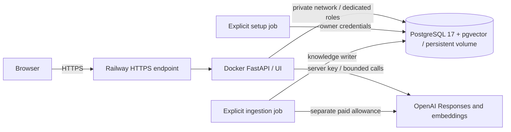

# Public demo deployment

[Documentation index](README.md)

Stage 8 preparation targets **Railway**. No public deployment or demo URL has
been verified yet. Hosting, account access and paid-test/public-chat budgets must
be selected before provisioning paid resources. The repository configuration is
reviewable independently of an account; see [verification](verification.md).

## Services and boundaries



Use one region and one API replica initially. The existing UI is served by
FastAPI; a separate frontend service or nginx container is unnecessary. Railway
terminates HTTPS, while Uvicorn listens on `PORT` (default 8000). The entrypoint
[`scripts.serve`](../scripts/serve.py) disables access logs and proxy-header trust;
no decisions depend on forwarded IPs. Graceful shutdown waits up to 130 seconds,
with a 150-second Railway drain setting. These are cooperative process controls.

Railway's standard PostgreSQL image does **not** include pgvector. Use the exact
`pgvector/pgvector:0.8.6-pg17-bookworm` image as a dedicated database service and
mount a volume at `/var/lib/postgresql/data`. Do not enable a public TCP proxy.
API/jobs connect to `db.railway.internal:5432`. This is a custom database service;
we must manage database maintenance, backups and restore verification.
[Database services](https://docs.railway.com/databases/build-a-database-service),
[pgvector support](https://docs.railway.com/databases/postgresql),
[private networking](https://docs.railway.com/networking/private-networking).

## Account and cost decisions

Railway Hobby has a $5 monthly minimum, including $5 resource usage; higher usage
costs more. An infrastructure planning allowance of $15/month is an estimate,
not a fixed price or an authorization. OpenAI and optional domains are separate.
[Current Railway pricing](https://railway.com/pricing).

Set a Railway Compute Usage alert/hard limit to the agreed infrastructure budget.
A reached hard limit takes workloads offline. Railway Agent Usage is a different
product and does **not** limit QueryLens's OpenAI API spending.
[Cost controls](https://docs.railway.com/pricing/cost-control).

For OpenAI use a dedicated project/key and account controls in addition to the
application's conservative public admission policy. Ingestion, admin CLI calls
and local evaluation are outside the HTTP ledger and need separate explicit
allowances. Review the dated model prices before enabling paid public traffic.

## Create the services

1. Create a Railway project with an API service sourced from this repository.
   Use [`railway.toml`](../railway.toml), the Dockerfile builder, one replica and
   `/health/ready`. Disable serverless sleeping if always-on access is required.
2. Create a `db` service from the pinned image above with its persistent volume.
   Set `POSTGRES_USER`, `POSTGRES_DB` and a generated `POSTGRES_PASSWORD` there.
   Verify the volume mount before allowing data jobs to run.
3. Create a temporary setup service from the same source, with Config File path
   `/deploy/railway-jobs.toml`. It runs [`scripts.deploy_setup`](../scripts/deploy_setup.py)
   once, has no domain/healthcheck, and uses `restartPolicyType=NEVER`. Disable
   automatic GitHub deployments for jobs; run them only when explicitly needed.
   [Configuration reference](https://docs.railway.com/config-as-code/reference).
4. Keep the API domain ungenerated until foundation/ingestion/limits are verified.
   Create the domain afterward; Railway provides automatic certificates.
   [Public HTTPS](https://docs.railway.com/networking/public-networking).

The repository configuration does not create services, volumes, secrets or billing
limits. Setting an image or file path in the guide is not deployment evidence.
Do not substitute an image tag that changes PostgreSQL major versions.

## Server-side variables

Set common DB coordinates on API/jobs: `POSTGRES_HOST=db.railway.internal`,
`POSTGRES_PORT=5432`, `POSTGRES_DB` matching the DB. A Railway reference such as
`${{db.RAILWAY_PRIVATE_DOMAIN}}` can supply the host. Use generated, distinct
passwords of at least 16 characters; never paste their values into chat or Git.

| Service/job | Secrets |
|---|---|
| PostgreSQL | Owner `POSTGRES_PASSWORD` |
| Setup job | Owner `POSTGRES_USER`/`POSTGRES_PASSWORD`; analytics reader, knowledge writer, knowledge reader and demo control passwords |
| Public API | `ANALYTICS_READONLY_PASSWORD`, `KNOWLEDGE_READONLY_PASSWORD`, `DEMO_CONTROL_PASSWORD`, `OPENAI_API_KEY` |
| Ingestion job | `KNOWLEDGE_WRITER_PASSWORD`, `OPENAI_API_KEY` |

The public API needs neither owner nor knowledge writer credentials. In public
mode, readiness uses `querylens_demo_control`, which can read the migration
version and operate only the admission ledger. Analytics and knowledge remain
accessible only through their dedicated tools. Local Compose retains its admin
health environment for development; use the service-specific production matrix.

Set on the API and setup job:

```dotenv
PUBLIC_DEMO_ENABLED=true
PUBLIC_CHAT_MONTHLY_BUDGET_USD=0
PUBLIC_CHAT_REQUESTS_PER_MINUTE=6
PUBLIC_CHAT_MAX_CONCURRENT=1
LLM_MODEL=gpt-5.4-mini
LLM_MAX_INPUT_BYTES=128000
LLM_MAX_OUTPUT_TOKENS=4000
EMBEDDING_MODEL=text-embedding-3-small
EMBEDDING_DIMENSIONS=1536
EMBEDDING_INDEX_VERSION=v1
KNOWLEDGE_INDEX_NAME=default
```

Use an agreed monthly amount instead of zero only after review. Keep the other
LLM budgets/timeouts identical on setup and API; the policy fingerprint includes
these settings. See [configuration](configuration.md) for their defaults.
When Railway's environment ID is present, startup rejects disabled public controls.

## Explicit foundation, ingestion and policy jobs

The setup service executes these steps sequentially, stops on the first failure,
and emits only step/status summaries. It captures child output to avoid forwarding
connection errors. It never runs ingestion or invokes a provider:

```bash
python -m scripts.deploy_setup
```

Local Compose can exercise the same offline job with an explicit public policy:

```bash
PUBLIC_DEMO_ENABLED=true docker compose run --rm deploy-setup
```

Equivalent separate commands, inside the setup service environment:

```bash
python -m alembic upgrade head
python -m scripts.provision_roles
python -m scripts.seed
python -m scripts.verify_data
python -m scripts.demo_policy --configure
```

Seeding is repeatable and refuses differing analytics data; no implicit `--replace`.
Policy configuration refuses active leases and preserves all existing charges.
Migrations/provisioning require the dedicated cluster's administrator.

Run ingestion as a separate explicit job from the same built image, with only
writer credentials, embedding settings and the server key. Only after agreeing on
its paid allowance, create the service with Config File path
`/deploy/railway-ingest.toml`, which runs ingestion once with no restart retries.
Use the image locally or a temporary dry-run job to inspect the corpus first:

```bash
python -m scripts.ingest --dry-run
# Only after a separately approved ingestion allowance:
python -m scripts.ingest
```

The current corpus has 25 chunks / 15942 bytes. The existing ingestion provider's
250000-byte attempted-input cap reserves at most $0.005 with the reviewed small
embedding price, excluding taxes. This reserve is separate from public chat.
No startup/restart should repeat ingestion. Reuse is supported; changes in vector
space require explicit [reindexing](retrieval.md). Disable automatic deployment
and retries for the ingestion service, and remove its secrets when it is retired.

To change public policy, pause/remove public access and stop/drain every API worker;
configure the new policy using the owner job with matching settings, then redeploy
API workers. An old fingerprint fails closed instead of bypassing the new policy.
For an individual remote admin command, use a temporary owner job with its own
explicit config file/start command and no restart retries. Config-as-code commands
override dashboard start commands; do not reuse the API/foundation config and
expect a dashboard command to replace it. Remove the job/secrets afterward.
Local commands for inspection/configuration:

```bash
docker compose run --rm demo-policy
PUBLIC_DEMO_ENABLED=true docker compose run --rm demo-policy \
  python -m scripts.demo_policy --configure
```

## Shared admission and recovery

[`app/demo_gate.py`](../app/demo_gate.py) uses a PostgreSQL transaction advisory
lock across all workers/replicas. Before any provider call it checks an explicitly
configured policy, global active leases, a fixed UTC-minute request window and
the current UTC-month allocation. It atomically adds the reservation and lease.
At defaults, one question reserves **$0.114320** (114320 micro-USD): 128000 input
bytes at $0.75/M, 4000 output tokens at $4.50/M, and 16000 embedding bytes at $0.02/M.
A $1 monthly allocation admits at most eight such questions, regardless of their
actual lower usage. Smaller request caps can increase this count but may exhaust
context before a question completes.

Prices are versioned `openai-standard-2026-10-09` in code, based on
[GPT-5.4 mini](https://developers.openai.com/api/docs/models/gpt-5.4-mini),
[small embeddings](https://developers.openai.com/api/docs/models/text-embedding-3-small)
and [large embeddings](https://developers.openai.com/api/docs/models/text-embedding-3-large).
Reservation uses UTF-8 byte/token bounds and the existing protocol allowance,
counts attempts with zero SDK retries, and ignores cached discounts. This is a
conservative admission allocation, **not a provider invoice or account billing
guarantee**; price changes, taxes or other callers require separate accounting.

Unused reserves are never refunded, including provider failures and lost usage.
Completed requests delete their lease; crashes/failed cleanup leave it durable
and block later traffic until recovery. There is no automatic lease expiry because
cooperative deadlines cannot prove that a provider request stopped. An API restart
does not reset rate counts or monthly reservations. Global limits do not identify
individual clients; one visitor can exhaust the shared demo allowance.

HTTP 429 distinguishes busy/rate/budget failures; rate/busy responses include
`Retry-After`. Policy/storage failures use HTTP 503. The UI displays fixed messages
and never retries automatically. Chat bodies are limited to 16384 received bytes
before parsing, including chunked bodies; questions still have the 2000-byte limit.
The ledger stores request IDs/timestamps/counters, never questions, SQL or secrets.

After a crash, stop **all** API workers first, inspect leases as administrator,
and release only the stale request ID. Keep its charge:

```bash
python -m scripts.demo_policy --status
python -m scripts.demo_policy --release-stale REQUEST_ID --all-workers-stopped
```

Do not clear the ledger to obtain additional paid calls. Restoring an older database
backup can restore earlier spending counters, so keep public traffic stopped and
reconcile charges before re-enabling it. Recovering data and resetting spending
are separate decisions.

## Backups and deployment acceptance

Configure daily volume backups and verify a restore before claiming recovery.
For a custom Postgres image, also keep a consistent logical `pg_dump` backup,
including role recovery/provisioning instructions; do not assume managed PITR.
[Volume backup schedules and limits](https://docs.railway.com/volumes/backups).
Backup files may contain role metadata/data and must stay private/outside Git.

Record actual evidence in [verification](verification.md) and add the real URL to
the root README only after deployment. Acceptance remains pending until:

- HTTPS loads `/`, assets, `/demo`, `/health/live` and `/health/ready`.
- Zero budget / invalid input / oversized body / busy / exhausted limits return
  the documented sanitized responses without provider calls.
- Restarting API and DB preserves the synthetic fingerprint, the real compatible
  knowledge index and admission counters; backups and recovery are verified.
- Five paid questions run **once** on the deployed version within an explicit
  test allowance; compare SQL cells and sources to independent references.

Suggested five prompts: September completed-order revenue; previous complete
calendar-week revenue; September active session users; September subscription
churn by plan; August signup-cohort conversion within 30 days. Use explicit UTC
windows and request raw ratios to eight decimal places for churn/conversion.
Independent values are in [`scripts/reference_values.json`](../scripts/reference_values.json).
Check all required definitions and fact-cell references, record failures and actual
usage; do not convert the stage 7 offline baseline into a semantic accuracy claim.
The original ARPU/ARPPU live report remains unchanged with strict failures.
