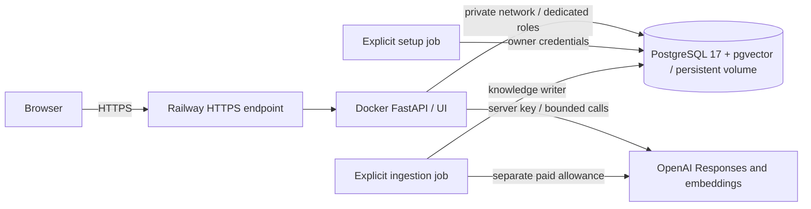

# Public demo deployment

[Documentation index](README.md)

Stage 8 targets **Railway**. The public UI/API foundation is verified at
[querylens-production-f241.up.railway.app](https://querylens-production-f241.up.railway.app/),
with [Swagger documentation](https://querylens-production-f241.up.railway.app/docs).
Live knowledge ingestion has stored 25 chunks using `text-embedding-3-small`
(1536 dimensions). Live AI answers, hosted restart persistence and backup
recovery remain pending. Additional paid jobs/public-chat budgets require an
explicit allowance. See [verification](verification.md) for completed checks.

The author approved a shared $1/month public-chat allocation on 2026-10-11.
It is configured on API/setup and in the database policy. At the current default
reservation, it admits at most eight questions per UTC calendar month across
all visitors. The author subsequently added the API's OpenAI key and redeployed;
adding that key alone does not change the policy fingerprint. Railway usage and explicit CLI/ingestion jobs
are outside this allocation.

As verified on 2026-10-11, Railway no longer allows new services to opt into
Config as Code. Existing users of `railway.toml` / `railway.json` retain support
only until 2026-12-01. The TOML files in this repository are legacy references,
not an applied configuration for the new deployment. Use the dashboard settings
below; a future IaC migration must be reviewed separately before applying it.
[Current Config as Code status](https://docs.railway.com/config-as-code).

## Services and boundaries



Use one region and one API replica initially. The existing UI is served by
FastAPI; a separate frontend service or nginx container is unnecessary. Railway
terminates HTTPS, while Uvicorn listens on `PORT` (default 8000). The entrypoint
[`scripts.serve`](../scripts/serve.py) disables access logs and proxy-header trust;
no decisions depend on forwarded IPs. Graceful shutdown waits up to 130 seconds,
with a 150-second Railway drain setting. These are cooperative process controls.

Railway's standard PostgreSQL image does **not** include pgvector. Use the exact
`pgvector/pgvector:0.8.6-pg17-bookworm` image as a dedicated database service and
mount a volume at `/var/lib/postgresql/data`. Do not enable a public TCP proxy.
For a fresh Railway volume, set `PGDATA=/var/lib/postgresql/data/pgdata` on `db`.
The filesystem root may contain `lost+found`; PostgreSQL initialization needs an
empty data directory, so use this subdirectory inside the persistent mount.
Do not change `PGDATA` on an already initialized database without a data migration.
API/jobs connect to `db.railway.internal:5432`. This is a custom database service;
we must manage database maintenance, backups and restore verification.
[Database services](https://docs.railway.com/databases/build-a-database-service),
[pgvector support](https://docs.railway.com/databases/postgresql),
[private networking](https://docs.railway.com/networking/private-networking).

## Inspect the hosted database

Install the current Railway CLI (`brew install railway` on macOS), run
`railway login`, then `railway link` from the repository root and select the
existing project and production environment. Open the running database container:

```bash
railway ssh --service db --environment production
```

The CLI prompts for SSH key registration if needed. Inside that container,
the PostgreSQL client is available. Use the analytics reader for data inspection:

```bash
psql -h 127.0.0.1 -p 5432 -U querylens_analytics_ro -d "$POSTGRES_DB" -W
```

Enter the hosted `ANALYTICS_READONLY_PASSWORD` from `setup` Variables at the
password prompt; do not put it in a command or share terminal output containing
secrets. In `psql`, `\dt analytics.*` lists tables and
`SELECT * FROM analytics.orders LIMIT 10;` previews orders. Exit with `\q`.
For chunks, reconnect as `querylens_knowledge_ro` using the hosted
`KNOWLEDGE_READONLY_PASSWORD`, then run:

```sql
SELECT source_path, heading, ordinal, content
FROM knowledge.chunks
WHERE index_name = 'default'
ORDER BY source_path, ordinal;
```

For a GUI client, run this on the laptop and keep it open:

```bash
railway connect db --environment production --tunnel-only --port 15432
```

Connect the GUI to `127.0.0.1:15432`, the database name from `db.POSTGRES_DB`,
and the desired reader credentials. The CLI prints connection details including
secrets: keep that output private. The tunnel ends with Ctrl+C. These commands
were reviewed against current documentation, not executed against the hosted DB.
If `connect` cannot handle the custom database service, use the SSH config path:

```bash
railway ssh config --service db --environment production --alias querylens-db
ssh -N -L 127.0.0.1:15432:127.0.0.1:5432 querylens-db
```

This forwards the same database port. A direct SSH tunnel was successfully used
for policy administration on 2026-10-11 after `connect --tunnel-only` exited
unsuccessfully; no public TCP endpoint was created.
[Railway SSH](https://docs.railway.com/cli/ssh),
[database tunnels](https://docs.railway.com/cli/connect),
[CLI installation](https://docs.railway.com/cli).

## Account and cost decisions

Railway Hobby has a $5 monthly minimum, including $5 resource usage; higher usage
costs more. An infrastructure planning allowance of $15/month is an estimate,
not a fixed price or an authorization. OpenAI and optional domains are separate.
[Current Railway pricing](https://railway.com/pricing).

Set a Railway Compute Usage alert/hard limit to the agreed infrastructure budget.
A reached hard limit takes workloads offline. Railway Agent Usage is a different
product and does **not** limit QueryLens's OpenAI API spending.
[Cost controls](https://docs.railway.com/pricing/cost-control).

For OpenAI use a dedicated project/key and account controls in addition to the
application's conservative public admission policy. Ingestion, admin CLI calls
and local evaluation are outside the HTTP ledger and need separate explicit
allowances. Review the dated model prices before enabling paid public traffic.

## Create the services

1. Create a Railway project with an API service sourced from this repository.
   In Settings, select the Dockerfile builder and set Start Command to
   `python -m scripts.serve`. Use one replica, Healthcheck Path `/health/ready`
   with a 120-second timeout, and On Failure restart policy with three retries.
   Set the drain period to 150 seconds where supported. Disable serverless
   sleeping if always-on access is required. Confirm effective settings instead
   of assuming [`railway.toml`](../railway.toml) is read.
2. Create a `db` service from the pinned image above with its persistent volume.
   Set `POSTGRES_USER`, `POSTGRES_DB`, a generated `POSTGRES_PASSWORD`, and
   `PGDATA=/var/lib/postgresql/data/pgdata` there.
   Verify the volume mount before allowing data jobs to run.
3. Create a temporary `setup` service from the same GitHub repository. In Settings,
   use the Dockerfile builder, set Start Command to `python -m scripts.deploy_setup`,
   and select Never for Restart Policy. It runs
   [`scripts.deploy_setup`](../scripts/deploy_setup.py) once, has no domain/healthcheck.
   [`deploy/railway-jobs.toml`](../deploy/railway-jobs.toml) is a legacy reference. Disable
   automatic GitHub deployments for jobs; run them only when explicitly needed.
   [Start commands](https://docs.railway.com/deployments/start-command).
4. Keep the API domain ungenerated until foundation/ingestion/limits are verified.
   Create the domain afterward; Railway provides automatic certificates.
   [Public HTTPS](https://docs.railway.com/networking/public-networking).

The repository configuration does not create services, volumes, secrets or billing
limits. Setting an image or file path in the guide is not deployment evidence.
Do not substitute an image tag that changes PostgreSQL major versions.

## Server-side variables

Set common DB coordinates on API/jobs: `POSTGRES_HOST=db.railway.internal`,
`POSTGRES_PORT=5432`, `POSTGRES_DB` matching the DB. A Railway reference such as
`${{db.RAILWAY_PRIVATE_DOMAIN}}` can supply the host. Use generated, distinct
passwords of at least 16 characters; never paste their values into chat or Git.

| Service/job | Secrets |
|---|---|
| PostgreSQL | Owner `POSTGRES_PASSWORD` |
| Setup job | Owner `POSTGRES_USER`/`POSTGRES_PASSWORD`; analytics reader, knowledge writer, knowledge reader and demo control passwords |
| Public API | `ANALYTICS_READONLY_PASSWORD`, `KNOWLEDGE_READONLY_PASSWORD`, `DEMO_CONTROL_PASSWORD`, `OPENAI_API_KEY` |
| Ingestion job | `KNOWLEDGE_WRITER_PASSWORD`, `OPENAI_API_KEY` |

The public API needs neither owner nor knowledge writer credentials. In public
mode, readiness uses `querylens_demo_control`, which can read the migration
version and operate only the admission ledger. Analytics and knowledge remain
accessible only through their dedicated tools. Local Compose retains its admin
health environment for development; use the service-specific production matrix.

For `setup`, reference `POSTGRES_HOST=${{db.RAILWAY_PRIVATE_DOMAIN}}`,
`POSTGRES_DB=${{db.POSTGRES_DB}}`, `POSTGRES_USER=${{db.POSTGRES_USER}}` and
`POSTGRES_PASSWORD=${{db.POSTGRES_PASSWORD}}`, and set `POSTGRES_PORT=5432`.
Generate four distinct role passwords of at least 16 characters for
`ANALYTICS_READONLY_PASSWORD`, `KNOWLEDGE_WRITER_PASSWORD`,
`KNOWLEDGE_READONLY_PASSWORD` and `DEMO_CONTROL_PASSWORD`; none may equal the owner
password. Keep those values in Railway only. The later API and ingestion services
must use the matching reader/control and writer passwords respectively.
Do not copy the owner's user/password into the public API.

After setup completes, configure a separate `querylens` API service from the
same repository. If the initial API service was renamed/reconfigured to `setup`,
create a new API service rather than exposing the administrator job. The following
Railway references avoid copying secret values; retain `setup` with autodeploy
disabled while other services reference its variables:

```dotenv
POSTGRES_HOST=${{db.RAILWAY_PRIVATE_DOMAIN}}
POSTGRES_PORT=5432
POSTGRES_DB=${{db.POSTGRES_DB}}
ANALYTICS_READONLY_PASSWORD=${{setup.ANALYTICS_READONLY_PASSWORD}}
KNOWLEDGE_READONLY_PASSWORD=${{setup.KNOWLEDGE_READONLY_PASSWORD}}
DEMO_CONTROL_PASSWORD=${{setup.DEMO_CONTROL_PASSWORD}}
PUBLIC_DEMO_ENABLED=true
PUBLIC_CHAT_MONTHLY_BUDGET_USD=0
```

If `setup` will be deleted, transfer its role secrets to appropriately scoped
variables and update all references first; deleting the source breaks references.
The API does not need `POSTGRES_USER`, `POSTGRES_PASSWORD` or writer credentials.
With the API start command and readiness healthcheck configured above, redeploy
and require `/health/ready` to return `status: ready` with all three checks true.
This checks the DB, migrations and vector extension, not knowledge ingestion or
provider readiness; an OpenAI key is unnecessary for this foundation check.

Set on the API and setup job:

```dotenv
PUBLIC_DEMO_ENABLED=true
PUBLIC_CHAT_MONTHLY_BUDGET_USD=0
PUBLIC_CHAT_REQUESTS_PER_MINUTE=6
PUBLIC_CHAT_MAX_CONCURRENT=1
LLM_MODEL=gpt-5.4-mini
LLM_MAX_INPUT_BYTES=128000
LLM_MAX_OUTPUT_TOKENS=4000
EMBEDDING_MODEL=text-embedding-3-small
EMBEDDING_DIMENSIONS=1536
EMBEDDING_INDEX_VERSION=v1
KNOWLEDGE_INDEX_NAME=default
```

Use an agreed monthly amount instead of zero only after review. Keep the other
LLM budgets/timeouts identical on setup and API; the policy fingerprint includes
these settings. See [configuration](configuration.md) for their defaults.
When Railway's environment ID is present, startup rejects disabled public controls.

## Explicit foundation, ingestion and policy jobs

The setup service executes these steps sequentially, stops on the first failure,
and emits only step/status summaries. It captures child output to avoid forwarding
connection errors. It never runs ingestion or invokes a provider:

```bash
python -m scripts.deploy_setup
```

Local Compose can exercise the same offline job with an explicit public policy:

```bash
PUBLIC_DEMO_ENABLED=true docker compose run --rm deploy-setup
```

Equivalent separate commands, inside the setup service environment:

```bash
python -m alembic upgrade head
python -m scripts.provision_roles
python -m scripts.seed
python -m scripts.verify_data
python -m scripts.demo_policy --configure
```

Seeding is repeatable and refuses differing analytics data; no implicit `--replace`.
Policy configuration refuses active leases and preserves all existing charges.
Migrations/provisioning require the dedicated cluster's administrator.

Run ingestion as a separate explicit job from the same built image, with only
writer credentials, embedding settings and the server key. Only after agreeing on
its paid allowance, create the service with dashboard Start Command
`python -m scripts.ingest`, Never restart policy, and no domain/healthcheck.
[`deploy/railway-ingest.toml`](../deploy/railway-ingest.toml) is a legacy reference.
Name the temporary service `ingest`, disable GitHub autodeploy, and configure:

```dotenv
POSTGRES_HOST=${{db.RAILWAY_PRIVATE_DOMAIN}}
POSTGRES_PORT=5432
POSTGRES_DB=${{db.POSTGRES_DB}}
KNOWLEDGE_WRITER_PASSWORD=${{setup.KNOWLEDGE_WRITER_PASSWORD}}
EMBEDDING_MODEL=text-embedding-3-small
EMBEDDING_DIMENSIONS=1536
EMBEDDING_INDEX_VERSION=v1
KNOWLEDGE_INDEX_NAME=default
```

The real command additionally needs `OPENAI_API_KEY`, entered by the user into
Railway Variables. It does not need owner, analytics reader or control credentials.
While allowance/key entry is pending, the reviewable offline command is
`python -m scripts.ingest --dry-run`; it does not connect to DB or OpenAI.
Switch to the real ingestion command only after the explicit paid allowance.
Use the image locally or a temporary dry-run job to inspect the corpus first:

```bash
python -m scripts.ingest --dry-run
# Only after a separately approved ingestion allowance:
python -m scripts.ingest
```

The current corpus has 25 chunks / 15942 bytes. The existing ingestion provider's
250000-byte attempted-input cap reserves at most $0.005 with the reviewed small
embedding price, excluding taxes. This reserve is separate from public chat.
No startup/restart should repeat ingestion. Reuse is supported; changes in vector
space require explicit [reindexing](retrieval.md). Disable automatic deployment
and retries for the ingestion service, and remove its secrets when it is retired.

To change public policy, pause/remove public access and stop/drain every API worker;
configure the new policy using the owner job with matching settings, then redeploy
API workers. An old fingerprint fails closed instead of bypassing the new policy.
For an individual remote admin command, use a temporary owner job with its own
explicit dashboard start command and no restart retries. For legacy services
that already use Config as Code, file commands override dashboard commands;
verify effective configuration before running any job. Remove the job/secrets afterward.
Local commands for inspection/configuration:

```bash
docker compose run --rm demo-policy
PUBLIC_DEMO_ENABLED=true docker compose run --rm demo-policy \
  python -m scripts.demo_policy --configure
```

## Shared admission and recovery

[`app/demo_gate.py`](../app/demo_gate.py) uses a PostgreSQL transaction advisory
lock across all workers/replicas. Before any provider call it checks an explicitly
configured policy, global active leases, a fixed UTC-minute request window and
the current UTC-month allocation. It atomically adds the reservation and lease.
At defaults, one question reserves **$0.114320** (114320 micro-USD): 128000 input
bytes at $0.75/M, 4000 output tokens at $4.50/M, and 16000 embedding bytes at $0.02/M.
A $1 monthly allocation admits at most eight such questions, regardless of their
actual lower usage. Smaller request caps can increase this count but may exhaust
context before a question completes.

Prices are versioned `openai-standard-2026-10-09` in code, based on
[GPT-5.4 mini](https://developers.openai.com/api/docs/models/gpt-5.4-mini),
[small embeddings](https://developers.openai.com/api/docs/models/text-embedding-3-small)
and [large embeddings](https://developers.openai.com/api/docs/models/text-embedding-3-large).
Reservation uses UTF-8 byte/token bounds and the existing protocol allowance,
counts attempts with zero SDK retries, and ignores cached discounts. This is a
conservative admission allocation, **not a provider invoice or account billing
guarantee**; price changes, taxes or other callers require separate accounting.

Unused reserves are never refunded, including provider failures and lost usage.
Completed requests delete their lease; crashes/failed cleanup leave it durable
and block later traffic until recovery. There is no automatic lease expiry because
cooperative deadlines cannot prove that a provider request stopped. An API restart
does not reset rate counts or monthly reservations. Global limits do not identify
individual clients; one visitor can exhaust the shared demo allowance.

HTTP 429 distinguishes busy/rate/budget failures; rate/busy responses include
`Retry-After`. Policy/storage failures use HTTP 503. The UI displays fixed messages
and never retries automatically. Chat bodies are limited to 16384 received bytes
before parsing, including chunked bodies; questions still have the 2000-byte limit.
The ledger stores request IDs/timestamps/counters, never questions, SQL or secrets.

After a crash, stop **all** API workers first, inspect leases as administrator,
and release only the stale request ID. Keep its charge:

```bash
python -m scripts.demo_policy --status
python -m scripts.demo_policy --release-stale REQUEST_ID --all-workers-stopped
```

Do not clear the ledger to obtain additional paid calls. Restoring an older database
backup can restore earlier spending counters, so keep public traffic stopped and
reconcile charges before re-enabling it. Recovering data and resetting spending
are separate decisions.

## Backups and deployment acceptance

Configure daily volume backups and verify a restore before claiming recovery.
For a custom Postgres image, also keep a consistent logical `pg_dump` backup,
including role recovery/provisioning instructions; do not assume managed PITR.
[Volume backup schedules and limits](https://docs.railway.com/volumes/backups).
Backup files may contain role metadata/data and must stay private/outside Git.

Record actual evidence in [verification](verification.md) and add the real URL to
the root README only after deployment. Acceptance remains pending until:

- HTTPS loads `/`, assets, `/demo`, `/health/live` and `/health/ready`.
- Zero budget / invalid input / oversized body / busy / exhausted limits return
  the documented sanitized responses without provider calls.
- Restarting API and DB preserves the synthetic fingerprint, the real compatible
  knowledge index and admission counters; backups and recovery are verified.
- Five paid questions run **once** on the deployed version within an explicit
  test allowance; compare SQL cells and sources to independent references.

Suggested five prompts: September completed-order revenue; previous complete
calendar-week revenue; September active session users; September subscription
churn by plan; August signup-cohort conversion within 30 days. Use explicit UTC
windows and request raw ratios to eight decimal places for churn/conversion.
Independent values are in [`scripts/reference_values.json`](../scripts/reference_values.json).
Check all required definitions and fact-cell references, record failures and actual
usage; do not convert the stage 7 offline baseline into a semantic accuracy claim.
The original ARPU/ARPPU live report remains unchanged with strict failures.
